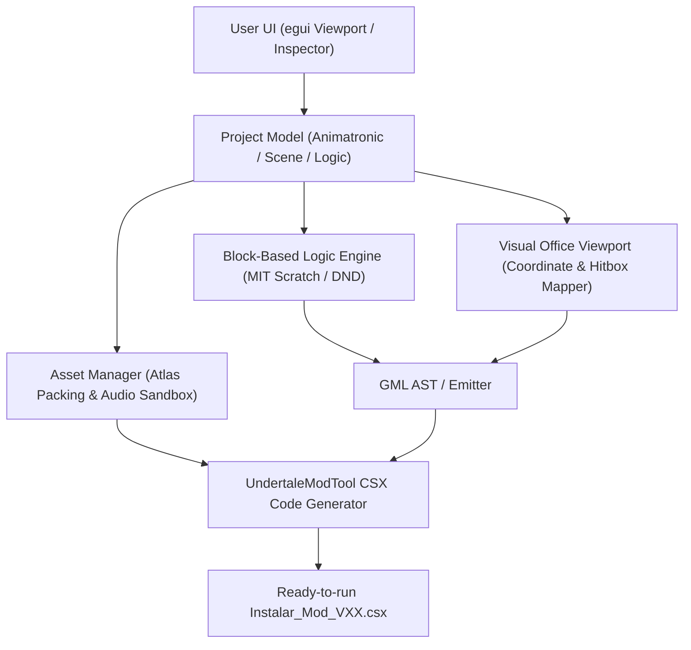

# FrickEditor — Rust Architecture & System Design

FrickEditor is designed as a modular, responsive desktop application written in **Rust** to provide visual authoring and automated code generation for *Five Nights at Frickbear's 3*.

---

## 1. Tech Stack
* **Language:** Rust (2021 edition)
* **GUI Framework:** `eframe` / `egui` (lightweight, immediate mode, instant startup) or `iced` / `tauri` (if web frontend is preferred).
* **Graphics Backend:** `wgpu` (Vulkan / DirectX 12 / Metal).
* **Image Processing:** `image` crate (PNG decoding, slicing, compositing, RGBA conversion).
* **Audio Playback (Preview):** `rodio` (OGG/WAV real-time preview in editor).
* **Serialization:** `serde`, `serde_json` (project save/load in `.frickmod`).
* **Code Template Engine:** `tera` or `minijinja` (generating UndertaleModTool `.csx` scripts).

---

## 2. Core Subsystems



### Module 1: `editor_core`
* Project state management (`ProjectContext`, `UndoStack`, `SaveSystem`).
* `.frickmod` project serializer and deserializer.

### Module 2: `viewport` (Visual 2D Office & Grid)
* Renders the Office panoramic view $(1920 \times 1080)$ and viewport $(640 \times 360)$.
* Allows dragging character anchors to Left Window $(160, 1085)$ or Right Window $(1462, 1085)$.
* Hitbox visualizer: click boundary for sunglasses/hats, light cone detection zone.
* Blind simulator: interactive toggle between Open, ForcedOpen, and Closed.

### Module 3: `block_logic` (Block-Based & State Machine Editor)
* Visual logic blocks (inspired by MIT Scratch and GameMaker Drag & Drop):
  - **Events:** `On Night Start`, `On Knock Timer Expire`, `On Blind Raised`, `On Flashlight`, `On Death Coin`, `On Game Over`.
  - **Actions:** `Play Audio Stream`, `Change Animation Frame`, `Move Position`, `Hold Blind Open`, `Trigger Jumpscare`, `Kill Player`.
  - **Conditions:** `If Blind Is Closed`, `If Flashlight Active`, `If Poster Is Sun`.
* Dual view: Users can toggle between visual blocks and generated GameMaker Language (GML) code.

### Module 4: `asset_pipeline`
* Handles sprite imports (`sMurray_body_0..5.png`, `sMurray_head.png`, etc.).
* Automated pre-compositor: generates single-texture canvases for jumpscare frames.
* Implements MaxRects bin-packing algorithm to generate valid GameMaker texture sheet additions.

### Module 5: `csx_generator` (Compiler to UndertaleModTool)
* Consumes the `ProjectContext` and compiles it into a standalone `.csx` C# script.
* Automates:
  1. Asset folder staging and sprite importing.
  2. Bytecode replacement via `importGroup.QueueReplace`.
  3. Safe room instance creation in `Office` and `CustomNightMenu`.
  4. Audio deployment to both game folder and `%LOCALAPPDATA%\Frickbears3`.
  5. Version incrementing per invariant rules (`Instalar_<Name>_V<N>.csx`).

---

## 3. Recommended Rust Crate Structure
```
frickeditor/
├── Cargo.toml
├── src/
│   ├── main.rs                  # Application entry point & eframe setup
│   ├── app.rs                   # Top-level UI layout (Menu, Sidebar, Central Viewport)
│   ├── model/                   # Data structures
│   │   ├── project.rs           # Project metadata and animatronic definition
│   │   ├── hitbox.rs            # Coordinates, bounding boxes, detection zones
│   │   └── logic_tree.rs        # FSM and block nodes
│   ├── view/                    # UI Panels
│   │   ├── office_canvas.rs     # Interactive 2D drag-and-drop viewport
│   │   ├── block_editor.rs      # Scratch-style node/block editor
│   │   ├── asset_inspector.rs   # Sprite sequences, preview player
│   │   └── gallery_editor.rs    # Extras info & salvage tape editor
│   ├── compiler/                # CSX Code Generator
│   │   ├── template.rs          # Template engine integration
│   │   ├── gml_emitter.rs       # Block-to-GML transpiler
│   │   └── packer.rs            # Texture atlas packer
│   └── util/
│       └── paths.rs             # LocalAppData and game path detection
└── templates/                   # CSX and GML Jinja/Tera templates
```
